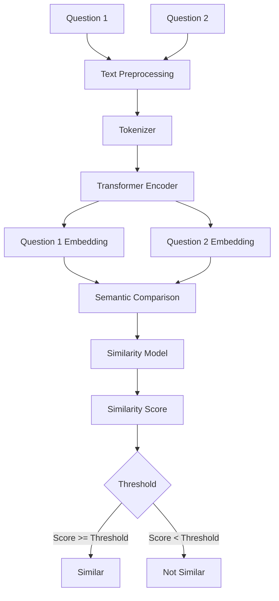
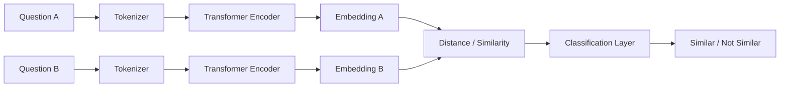

# 🧠 SemantiQ

### AI-Powered Semantic Question Similarity Detection System

<p align="center">
  
  
  
  
  
</p>

<p align="center">
  <b>Understand questions by meaning, not just by words.</b>
</p>

---

## 📌 Overview

**SemantiQ** is an AI and Deep Learning-based system designed to determine whether two questions are **semantically similar** or **different**, even when they use different words, sentence structures, or vocabulary.

Traditional keyword-based approaches can fail when two questions have the same meaning but contain different words.

For example:

> **Question 1:** What is Artificial Intelligence?
> **Question 2:** Explain the concept of AI.

Although these questions do not contain exactly the same words, their underlying meaning is very similar.

SemantiQ uses **Natural Language Processing (NLP)** and **Transformer-based Deep Learning models** to understand the semantic relationship between question pairs.

---

# 🎯 Problem Statement

Duplicate and semantically similar questions are common in:

* Online education platforms
* Question banks
* Examination systems
* FAQ systems
* E-learning applications
* Customer support systems
* Knowledge bases

A simple keyword matching system may consider the following questions different:

```text
What is machine learning?

Explain machine learning.
```

However, from a semantic perspective, both questions are asking about the same concept.

### The goal of SemantiQ is to:

> **Determine whether two questions have the same or similar meaning using Deep Learning and NLP.**

---

# 🚀 Key Features

* 🔍 Semantic similarity detection
* 🧠 Transformer-based NLP
* 🤖 BERT / SBERT embeddings
* 📊 Similarity score generation
* ✅ Similar / Not Similar classification
* 📝 Duplicate question detection
* ⚡ Fast inference
* 📈 Model evaluation
* 🌐 User-friendly interface
* 🔌 API support
* 📦 Modular ML pipeline

---

# 💡 Example

### Example 1 — Similar Questions

```text
Question 1:
What is Artificial Intelligence?

Question 2:
Explain the concept of AI.
```

### Output

```text
Prediction: SIMILAR
Similarity Score: 91.4%
Confidence: High
```

---

### Example 2 — Different Questions

```text
Question 1:
What is Artificial Intelligence?

Question 2:
How does photosynthesis occur?
```

### Output

```text
Prediction: NOT SIMILAR
Similarity Score: 8.7%
Confidence: High
```

---

# 🏗️ System Architecture



---

# 🧠 Deep Learning Pipeline

SemantiQ follows a multi-stage NLP pipeline.

```text
Raw Questions
      ↓
Text Cleaning
      ↓
Tokenization
      ↓
Transformer Encoder
      ↓
Contextual Embeddings
      ↓
Semantic Comparison
      ↓
Similarity Model
      ↓
Similarity Score
      ↓
Classification
      ↓
Similar / Not Similar
```

---

# 🔬 How It Works

## 1️⃣ Input

The user provides two questions:

```text
Question A
Question B
```

---

## 2️⃣ Text Preprocessing

The input text is normalized before passing it to the model.

Possible preprocessing steps include:

* Lowercasing
* Removing unnecessary whitespace
* Handling punctuation
* Unicode normalization
* Removing unwanted characters
* Handling missing values

Example:

```text
"  What IS Machine Learning???  "
```

becomes approximately:

```text
"what is machine learning?"
```

> Note: For Transformer models, aggressive preprocessing is generally avoided because punctuation and word structure can contain useful semantic information.

---

# 3️⃣ Tokenization

The processed questions are converted into tokens using a Transformer tokenizer.

Example:

```text
"What is machine learning?"
```

↓

```text
["what", "is", "machine", "learning", "?"]
```

The tokenizer then converts these tokens into numerical IDs that the neural network can process.

---

# 4️⃣ Transformer Encoder

SemantiQ uses a Transformer-based architecture to generate contextual representations.

Possible models:

* BERT
* RoBERTa
* DistilBERT
* Sentence-BERT
* MiniLM

The model learns contextual relationships between words.

For example:

```text
"bank"

```

can have different meanings depending on context:

```text
I deposited money in the bank.
```

vs.

```text
We sat near the river bank.
```

Transformer models can capture this contextual difference.

---

# 5️⃣ Sentence Embeddings

Each question is converted into a numerical vector.

Example:

```text
Question 1 → [0.21, -0.14, 0.83, ...]
Question 2 → [0.19, -0.11, 0.79, ...]
```

These vectors represent the semantic meaning of the questions.

---

# 6️⃣ Semantic Comparison

The two embeddings are compared using methods such as:

### Cosine Similarity

```text
similarity(A,B) =
        A · B
        -------
        ||A|| ||B||
```

The result is generally interpreted as a similarity score.

For example:

```text
0.94 → Highly Similar
0.72 → Related
0.18 → Mostly Different
```

The exact threshold should be selected using validation data rather than arbitrarily assuming one universal value.

---

# 7️⃣ Classification

The similarity information can be passed to a classification layer.

```text
Similarity Features
        ↓
Dense Layer
        ↓
Dropout
        ↓
Output Layer
        ↓
Similar / Not Similar
```

---

# 🧬 Advanced Architecture — Siamese Network

An advanced version of SemantiQ can use a **Siamese Transformer Network**.



The two branches share the same encoder architecture and parameters.

This allows the model to learn a common semantic representation for both questions.

---

# 📊 Dataset

The model requires a dataset containing pairs of questions and their similarity labels.

Example:

| Question 1          | Question 2                       | Label |
| ------------------- | -------------------------------- | ----- |
| What is AI?         | Explain Artificial Intelligence. | 1     |
| What is Python?     | How does photosynthesis work?    | 0     |
| What is ML?         | Define machine learning.         | 1     |
| What is a database? | What is the weather today?       | 0     |

Where:

```text
1 = Similar
0 = Not Similar
```

---

# 📚 Possible Dataset

A suitable starting point is the **Quora Question Pairs (QQP)** dataset.

It contains question pairs with a binary label indicating whether the questions are duplicate/similar.

Other datasets can also be considered depending on the project's final objective.

---

# 🧪 Model Training

The training process can follow:

```text
Dataset
   ↓
Train / Validation / Test Split
   ↓
Tokenization
   ↓
Transformer Encoder
   ↓
Question Embeddings
   ↓
Similarity Features
   ↓
Classifier
   ↓
Loss Calculation
   ↓
Backpropagation
   ↓
Weight Update
   ↓
Repeat
```

---

# 📈 Evaluation Metrics

The model should not be evaluated using accuracy alone.

Recommended metrics:

### Accuracy

Measures the percentage of correct predictions.

### Precision

Measures how many predicted similar pairs are actually similar.

### Recall

Measures how many actual similar pairs were detected.

### F1 Score

Balances precision and recall.

### ROC-AUC

Useful for evaluating binary classification performance across thresholds.

### Confusion Matrix

```text
                 Predicted
              Similar  Different

Actual Similar    TP       FN

Actual Different  FP       TN
```

---

# 📊 Model Comparison

For a stronger final-year project, compare multiple approaches.

| Model        | Approach             | Expected Benefit         |
| ------------ | -------------------- | ------------------------ |
| TF-IDF       | Traditional NLP      | Baseline                 |
| Word2Vec     | Word embeddings      | Semantic representation  |
| LSTM         | Deep Learning        | Sequence modeling        |
| BERT         | Transformer          | Contextual understanding |
| SBERT        | Sentence embeddings  | Efficient similarity     |
| Siamese BERT | Deep metric learning | Pairwise similarity      |

This comparison makes the project more academically meaningful because you can demonstrate how semantic similarity performance changes from traditional NLP to modern Transformer-based approaches.

---

# 🖥️ User Interface

The application can provide a simple interface:

```text
┌───────────────────────────────────────────┐
│                SemantiQ                   │
│     Semantic Question Similarity          │
├───────────────────────────────────────────┤
│                                           │
│ Question 1                                │
│ ┌───────────────────────────────────────┐ │
│ │ What is machine learning?             │ │
│ └───────────────────────────────────────┘ │
│                                           │
│ Question 2                                │
│ ┌───────────────────────────────────────┐ │
│ │ Explain the concept of machine        │ │
│ │ learning.                             │ │
│ └───────────────────────────────────────┘ │
│                                           │
│             [ Compare Questions ]         │
│                                           │
├───────────────────────────────────────────┤
│ Similarity Score: 91.4%                   │
│                                           │
│ Prediction: 🟢 SIMILAR                    │
│ Confidence: High                          │
└───────────────────────────────────────────┘
```

---

# 📁 Project Structure

```text
SemantiQ/
│
├── data/
│   ├── raw/
│   ├── processed/
│   └── README.md
│
├── notebooks/
│   ├── 01_data_exploration.ipynb
│   ├── 02_preprocessing.ipynb
│   ├── 03_baseline_model.ipynb
│   ├── 04_transformer_training.ipynb
│   └── 05_model_evaluation.ipynb
│
├── src/
│   ├── data/
│   │   ├── loader.py
│   │   └── preprocessing.py
│   │
│   ├── models/
│   │   ├── bert_model.py
│   │   ├── siamese_model.py
│   │   └── classifier.py
│   │
│   ├── training/
│   │   ├── train.py
│   │   └── evaluate.py
│   │
│   └── inference/
│       └── predictor.py
│
├── app/
│   └── app.py
│
├── api/
│   └── main.py
│
├── models/
│   └── trained_model/
│
├── tests/
│   ├── test_preprocessing.py
│   └── test_prediction.py
│
├── requirements.txt
├── .gitignore
├── README.md
└── LICENSE
```

---

# ⚙️ Tech Stack

## Programming Language

* Python

## Machine Learning

* Scikit-learn

## Deep Learning

* PyTorch
* Hugging Face Transformers

## NLP

* BERT
* Sentence-BERT
* Tokenizers
* Sentence Embeddings

## Data Processing

* Pandas
* NumPy

## Visualization

* Matplotlib
* Plotly

## Backend

* FastAPI

## Frontend

* Streamlit / React

## Database

* PostgreSQL / SQLite

## Development

* Jupyter Notebook
* Git
* GitHub

---

# 🛠️ Installation

## 1. Clone the Repository

```bash
git clone <YOUR_GITHUB_REPOSITORY_URL>
cd SemantiQ
```

---

## 2. Create Virtual Environment

### Windows

```bash
python -m venv .venv
```

Activate:

```bash
.venv\Scripts\activate
```

### Linux / macOS

```bash
python3 -m venv .venv
source .venv/bin/activate
```

---

## 3. Install Dependencies

```bash
pip install -r requirements.txt
```

---

# ▶️ Run the Application

If using Streamlit:

```bash
streamlit run app/app.py
```

If using FastAPI:

```bash
uvicorn api.main:app --reload
```

---

# 🔌 Example API Request

### Endpoint

```text
POST /predict
```

### Request

```json
{
    "question1": "What is machine learning?",
    "question2": "Explain the concept of machine learning."
}
```

### Response

```json
{
    "similarity_score": 0.914,
    "prediction": "Similar",
    "confidence": 0.942
}
```

---

# 🧠 Example Python Usage

```python
from src.inference.predictor import predict_similarity

question1 = "What is artificial intelligence?"
question2 = "Explain the concept of AI."

result = predict_similarity(question1, question2)

print(result)
```

Expected output:

```text
Similarity Score: 0.91
Prediction: Similar
```

---

# 🔐 Security & Reliability

For a production implementation, SemantiQ should also consider:

* Input validation
* Maximum input length
* API rate limiting
* Model versioning
* Logging
* Error handling
* Secure API configuration
* Protection against malicious inputs

---

# ⚡ Performance Optimization

For faster inference, the system can use:

* DistilBERT
* MiniLM
* Sentence-BERT
* Batch inference
* GPU acceleration
* Embedding caching
* ONNX/TorchScript optimization

For large-scale duplicate detection, precomputing embeddings and using a vector index can significantly reduce repeated computation.

---

# 🌍 Real-World Applications

### 🎓 Education

Detect duplicate questions in question banks.

### 📝 Examination Systems

Identify repeated or highly similar questions.

### 🤖 Chatbots

Find whether a new user question matches an existing FAQ.

### 💬 Customer Support

Match new queries with previously solved problems.

### 🔎 Search Systems

Retrieve semantically related questions.

### 📚 E-Learning

Organize similar questions automatically.

### 🗃️ Knowledge Management

Remove duplicate entries from large question databases.

---

# 🔮 Future Scope

SemantiQ can be extended beyond simple binary similarity classification.

### 1. Multilingual Question Similarity

Support:

```text
English
Hindi
Hinglish
Spanish
French
etc.
```

### 2. Question Clustering

Automatically group thousands of similar questions.

```text
                Question Dataset
                       ↓
                 Embeddings
                       ↓
                   Clustering
                 ↙     ↓      ↘
            Python     AI      DBMS
```

### 3. Duplicate Question Search

Instead of comparing only two questions, the system can search an entire database and return the most similar questions.

### 4. Semantic Search

Users can enter a question and retrieve relevant questions based on meaning.

### 5. Explainable Similarity

The system can highlight which concepts caused the questions to be considered similar.

### 6. Multimodal Questions

Future versions could support:

```text
Text
 ↓
Images
 ↓
Tables
 ↓
Diagrams
```

### 7. Large Language Model Integration

An LLM can be added for advanced semantic reasoning and explanation.

---

# 🧪 Research Direction

A more advanced version of SemantiQ can investigate:

```text
Traditional NLP
      ↓
Word Embeddings
      ↓
LSTM
      ↓
BERT
      ↓
SBERT
      ↓
Siamese Transformer
      ↓
Cross Encoder
```

The performance of each architecture can be compared using the same dataset and evaluation metrics.

This creates a strong experimental component for an academic/final-year project.

---

# 📌 Project Objectives

The major objectives of SemantiQ are:

1. Detect semantically similar question pairs.
2. Understand context rather than relying only on keywords.
3. Apply Transformer-based Deep Learning to NLP.
4. Generate meaningful similarity scores.
5. Reduce duplicate questions in large datasets.
6. Build a practical AI-based application.
7. Compare traditional NLP approaches with Deep Learning approaches.

---

# 📊 Expected Output

```text
┌───────────────────────────────────┐
│          SEMANTIQ RESULT          │
├───────────────────────────────────┤
│                                   │
│ Similarity Score      91.4%       │
│                                   │
│ Prediction            SIMILAR     │
│                                   │
│ Model                 SBERT       │
│                                   │
│ Confidence            HIGH        │
│                                   │
└───────────────────────────────────┘
```

---

# 📸 Screenshots

Add your actual application screenshots here after completing the UI.

### 🏠 Home Page

```text
docs/images/home.png
```


### 🔍 Similarity Prediction

```text
docs/images/result.png
```


### 📊 Model Performance

```text
docs/images/performance.png
```


> Replace these image paths with your actual screenshots.

---

# 🏆 Why SemantiQ?

Traditional systems often focus on **surface-level word matching**.

SemantiQ focuses on:

```text
Words
  ↓
Context
  ↓
Meaning
  ↓
Semantic Representation
  ↓
Similarity
```

The project demonstrates concepts from:

**Data Science → Machine Learning → Deep Learning → NLP → Transformers**

making it suitable as an academic and portfolio project.

---

# 👨‍💻 Project Development Roadmap

```text
Phase 1
Research & Problem Definition
        ↓
Phase 2
Dataset Collection
        ↓
Phase 3
Data Cleaning & EDA
        ↓
Phase 4
Traditional NLP Baseline
        ↓
Phase 5
Deep Learning Model
        ↓
Phase 6
Transformer / SBERT
        ↓
Phase 7
Model Evaluation
        ↓
Phase 8
API Development
        ↓
Phase 9
Frontend / Dashboard
        ↓
Phase 10
Testing & Deployment
```

---

# 📚 Learning Outcomes

By developing SemantiQ, you will gain practical experience in:

* Natural Language Processing
* Text preprocessing
* Semantic similarity
* Sentence embeddings
* Deep Learning
* Transformer architecture
* BERT / SBERT
* Model fine-tuning
* Classification
* Model evaluation
* API development
* Model deployment
* Git & GitHub

---

# ⚠️ Limitations

The system may have difficulty with:

* Ambiguous questions
* Very short questions
* Domain-specific terminology
* Sarcasm or implicit meaning
* Poorly written text
* Questions requiring external factual knowledge

Performance also depends on the quality, size, and domain coverage of the training data.

---

# 📜 License

This project is licensed under the **MIT License**.

---

# ⭐ Support

If you find this project useful, consider giving the repository a ⭐ on GitHub.

---

<p align="center">

### 🧠 SemantiQ

**From Keyword Matching to Semantic Understanding.**

Made with ❤️ using Python, NLP & Deep Learning.

</p>
